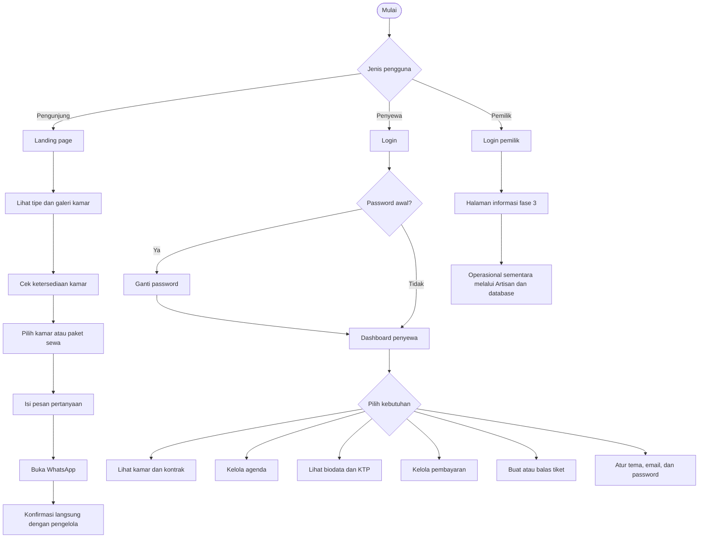
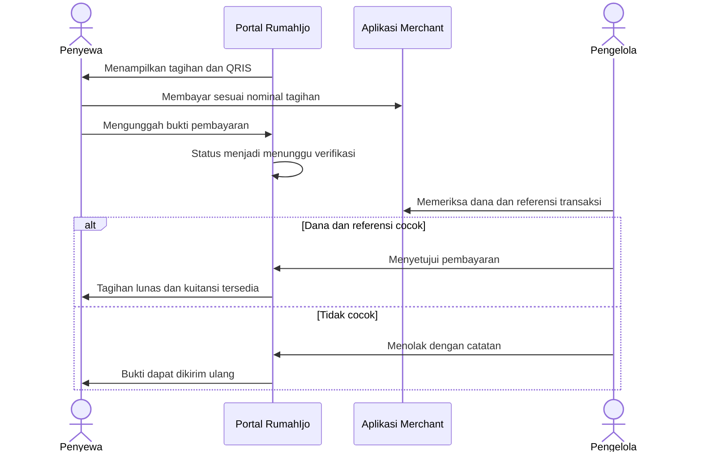

<div align="center">
  
  <h1>RumahIjo</h1>
  <p><strong>Landing page kost dan portal digital untuk penyewa RumahIjo.</strong></p>
  <p>Cari kamar, kelola masa sewa, pantau tagihan, kirim bukti pembayaran, dan hubungi pengelola dalam satu aplikasi.</p>
  <p>
    
    
    
    
    
  </p>
  <p>
    <a href="#-tentang-rumahijo">Tentang</a> ·
    <a href="#-fitur-utama">Fitur</a> ·
    <a href="#-user-flow">User flow</a> ·
    <a href="#-teknologi-dan-bahasa">Teknologi</a> ·
    <a href="#-menjalankan-proyek-di-lokal">Instalasi</a>
  </p>
</div>

> [!IMPORTANT]
> Proyek ini masih dalam tahap pengembangan. Portal penyewa sudah dapat diuji, sedangkan portal pemilik dan integrasi payment gateway otomatis belum tersedia. Pembayaran QRIS saat ini menggunakan unggah bukti dan verifikasi manual.

---

## 🏡 Tentang RumahIjo

RumahIjo adalah aplikasi web untuk membantu operasional kost RumahIjo sekaligus memberi pengalaman digital yang lebih rapi kepada calon penghuni dan penyewa aktif.

Aplikasi ini dibuat untuk:

- 🔎 membantu calon penghuni melihat tipe, harga, foto, dan ketersediaan kamar;
- 💬 mengarahkan pertanyaan kamar ke WhatsApp dengan pesan yang sudah disiapkan;
- 🏠 memberi penyewa ringkasan kamar dan masa kontrak;
- 💳 mengelola tagihan sewa, bukti QRIS, status verifikasi, dan kuitansi;
- 🎫 menyediakan kanal pelaporan fasilitas, pembayaran, kebersihan, dan kebutuhan lain;
- 📅 membantu penyewa menyimpan agenda pribadi;
- 🔐 menjaga biodata, KTP, foto profil, dan lampiran tetap privat sesuai hak akses.

### Pengguna aplikasi

| Pengguna | Kebutuhan | Akses saat ini |
|---|---|---|
| 👋 **Pengunjung** | Melihat informasi kost, pilihan kamar, galeri, harga, lokasi, dan kontak | Landing page publik |
| 🧑‍💼 **Penyewa** | Mengelola kamar, kontrak, biodata, agenda, tagihan, tiket, notifikasi, dan preferensi | Portal penyewa |
| 🛠️ **Pemilik/pengelola** | Mengelola kamar, penyewa, kontrak, tiket, dan pembayaran | Sebagian proses melalui database/seeder dan perintah Artisan; UI penuh masih fase berikutnya |

<div align="center">
  
</div>

## ✨ Fitur utama

### 🌿 Landing page publik

- Informasi brand, fasilitas, lokasi, dan cara menghubungi RumahIjo.
- Pilihan **KamarIjoku Kosongan, Isian, dan Full**.
- Galeri empat foto kamar dan detail furnitur.
- Pilihan permintaan furnitur untuk kamar Isian.
- Daftar ketersediaan kamar yang dibaca dari database dan diperbarui berkala.
- Formulir pertanyaan yang membuka WhatsApp untuk diperiksa sebelum dikirim.
- Chat pengunjung berlabel **DEMO** yang hanya tersimpan pada tab browser dan belum diteruskan ke pemilik.
- Tampilan responsif untuk desktop dan perangkat bergerak.

### 🧑‍💼 Portal penyewa

| Ikon | Modul | Kemampuan |
|---|---|---|
| 📊 | **Dashboard** | Ringkasan tagihan, kamar, sisa masa sewa, tiket, dan pengumuman |
| 📅 | **Kalender** | Membuat, mengubah, dan menghapus agenda pribadi |
| 🏠 | **Kamar Saya** | Melihat nomor kamar, fasilitas, harga, deposit, dan periode kontrak |
| 🪪 | **Biodata** | Melihat biodata, KTP privat, serta mengganti foto profil |
| 💳 | **Pembayaran** | Melihat tagihan, QRIS, riwayat pembayaran, status, dan kuitansi |
| 🎫 | **Ticketing** | Membuat tiket, membalas percakapan, dan mengirim maksimal tiga gambar |
| 🔔 | **Notifikasi** | Menerima pemberitahuan dalam aplikasi dan menandainya sebagai dibaca |
| ⚙️ | **Preferensi** | Tema terang/gelap, preferensi email, dan perubahan password |

### 🛡️ Keamanan dan kontrol akses

- Autentikasi berbasis sesi dan pembatasan percobaan login.
- Pemisahan peran `tenant` dan `owner`.
- Penyewa wajib mengganti password awal sebelum menggunakan portal.
- Policy kepemilikan untuk profil, tiket, tagihan, dan pembayaran.
- NIK disimpan terenkripsi dan hanya ditampilkan dalam bentuk tersamarkan.
- KTP, bukti pembayaran, avatar, dan lampiran tiket disimpan privat.
- Tautan bertanda tangan untuk mengakses dokumen privat.
- Audit aktivitas tanpa menyimpan isi password atau NIK.
- Validasi jenis, ukuran, dan jumlah berkas unggahan.

## 🧭 User flow

### Alur utama aplikasi



### Alur pembayaran QRIS saat ini



> [!WARNING]
> Bukti gambar bukan jaminan dana telah diterima. Pengelola harus mencocokkan nominal dan referensi pada aplikasi merchant sebelum menyetujui pembayaran.

## 🧰 Teknologi dan bahasa

### Bahasa yang digunakan

| Bahasa | Digunakan untuk |
|---|---|
| **PHP 8.3+** | Backend Laravel, controller, model, policy, service, command, dan pengujian server |
| **JavaScript / JSX** | Antarmuka React, interaksi pengguna, landing page, dan pengujian frontend |
| **CSS** | Layout, responsive design, tema, animasi, dan tampilan komponen |
| **SQL / SQLite** | Penyimpanan data lokal melalui migration, seeder, dan Eloquent ORM |
| **HTML / Blade** | Dokumen awal tempat aplikasi Inertia dimuat |

### Framework dan library

| Lapisan | Teknologi | Fungsi |
|---|---|---|
| Backend | **Laravel 13** | Routing, autentikasi, validasi, queue, scheduler, storage, dan domain aplikasi |
| Bridge | **Inertia.js 3** | Menghubungkan Laravel dan React tanpa API SPA terpisah |
| Frontend | **React 19** | Komponen dan state antarmuka |
| Build tool | **Vite 7** | Development server dan production bundle |
| Visual | **Three.js**, **React Three Fiber**, **GSAP** | Elemen 3D dan animasi landing page |
| Ikon | **Lucide React** | Ikon antarmuka yang konsisten |
| QR | **qrcode.react** | Menampilkan QR pembayaran |
| Database lokal | **SQLite** | Database default untuk pengembangan |
| Testing | **PHPUnit** dan **Node Test Runner** | Pengujian backend dan modul JavaScript |

## 🏗️ Arsitektur singkat

```text
Browser
  ├── Landing page React ────────> Ketersediaan kamar dari database
  └── Portal penyewa React
            │
            ▼
       Inertia.js
            │
            ▼
       Laravel 13
       ├── Routes & Middleware
       ├── Controllers & Policies
       ├── Services & Commands
       ├── Queue & Scheduler
       └── Eloquent ORM
            │
            ▼
          SQLite
```

### Struktur direktori penting

```text
rumahijo/
├── app/
│   ├── Console/Commands/       # Otomasi invoice dan review pembayaran
│   ├── Http/Controllers/       # Alur portal penyewa dan pembayaran
│   ├── Models/                 # Model domain aplikasi
│   ├── Policies/               # Otorisasi data
│   └── Services/               # Billing, QRIS, inventaris, dan audit
├── database/
│   ├── migrations/             # Struktur database
│   └── seeders/                # Data demo lokal
├── public/
│   ├── icons/3d/               # Logo dan aset ikon portal
│   └── payments/               # Aset QRIS statis
├── resources/js/Pages/         # Halaman portal Inertia + React
├── src/                        # Landing page publik
├── routes/web.php              # Rute web aplikasi
└── tests/                      # Pengujian feature dan unit
```

## 🚀 Menjalankan proyek di lokal

### Persyaratan

- PHP 8.3 atau lebih baru
- Composer
- Node.js dan npm
- Ekstensi PHP yang dibutuhkan Laravel dan SQLite

### Instalasi

```bash
git clone <url-repository>
cd rumahijo
composer install
npm install
cp .env.example .env
php artisan key:generate
touch database/database.sqlite
php artisan migrate --seed
npm run build
php artisan serve
```

Buka alamat yang ditampilkan oleh Artisan. Saat mengembangkan frontend, jalankan Vite pada terminal lain:

```bash
npm run dev
```

> [!CAUTION]
> Jika `.env` dan `APP_KEY` sudah tersedia, jangan menyalin ulang `.env.example` atau membuat key baru. Perubahan `APP_KEY` dapat membuat data terenkripsi yang sudah tersimpan tidak dapat dibaca.

### Menjalankan layanan latar belakang

Gunakan dua terminal terpisah agar invoice, notifikasi, dan email antrean dapat diproses:

```bash
php artisan schedule:work
```

```bash
php artisan queue:work --tries=3
```

## 🔑 Akun demo

Seeder menyediakan data uji berikut hanya untuk environment lokal atau staging.

| Peran | Email | Password |
|---|---|---|
| Penyewa | `budi@rumahijo.test` | `Penyewa#2026` |
| Penyewa | `siti@rumahijo.test` | `Penyewa#2026` |
| Penyewa | `dimas@rumahijo.test` | `Penyewa#2026` |
| Pemilik | `pemilik@rumahijo.test` | `Pemilik#2026` |

> [!NOTE]
> Jangan gunakan akun, password, QRIS, atau data contoh ini di production.

## 💳 Operasional pembayaran manual

Pembayaran QRIS belum memakai Midtrans, webhook, atau settlement otomatis. Nominal tagihan berasal dari server, sedangkan bukti pembayaran harus diperiksa oleh pengelola.

> [!WARNING]
> Aset QRIS statis yang saat ini tersimpan di proyek mencantumkan merchant **99FOODS**. Ganti dan verifikasi aset tersebut dengan QRIS resmi RumahIjo sebelum pembayaran sungguhan dibuka.

```bash
# Lihat pembayaran yang menunggu verifikasi
php artisan payments:pending

# Setujui setelah dana dan referensi benar-benar cocok
php artisan payments:review ID --approve --note="Dana dan referensi sudah cocok"

# Tolak dan berikan alasan
php artisan payments:review ID --reject --note="Jelaskan alasan penolakan"
```

Ganti `ID` dengan ID pembayaran. Persetujuan menghasilkan kuitansi yang dapat dicetak atau disimpan sebagai PDF. Penolakan mengembalikan tagihan ke status belum dibayar atau terlambat sehingga penyewa dapat mengirim bukti baru.

### Simulasi pembayaran lokal

Pada environment lokal, detail tagihan menyediakan simulasi pembayaran berhasil, gagal, atau kedaluwarsa. Simulasi tidak memindahkan uang dan seluruh transaksi serta kuitansinya diberi label.

```dotenv
PAYMENT_SIMULATION_ENABLED=true
```

Production tetap menolak simulasi walaupun konfigurasi tersebut bernilai `true`.

## ⏰ Invoice otomatis dan notifikasi

Invoice sewa otomatis hanya dibuat untuk kontrak **aktif** yang telah disepakati. Kontrak berstatus pending tidak akan diterbitkan otomatis.

- invoice diterbitkan tujuh hari sebelum jatuh tempo;
- pengingat dikirim pada H-3;
- invoice yang melewati jatuh tempo ditandai terlambat;
- kunci unik mencegah invoice periode yang sama dibuat dua kali;
- harga berasal dari `monthly_price` kontrak;
- pembelian token listrik tidak dimasukkan ke biaya sewa.

Perintah berikut dapat digunakan untuk pengujian manual:

```bash
php artisan invoices:generate
php artisan invoices:mark-overdue
php artisan invoices:remind
php artisan schedule:list
```

Zona waktu aplikasi adalah `Asia/Jakarta`. Pada konfigurasi development bawaan, email ditulis ke `storage/logs/laravel.log` setelah queue worker memproses antrean.

## 🧪 Pengujian

Jalankan seluruh pengujian backend dan frontend:

```bash
php artisan test --compact
npm test
npm run build
```

Cakupan utama meliputi otorisasi, dokumen privat, audit, password awal, profil, tema, kalender, lampiran tiket, invoice tanpa duplikat, inventaris kamar, QRIS manual, dan simulasi pembayaran.

## 🗺️ Status dan roadmap

### Sudah tersedia

- [x] Landing page dengan detail dan galeri kamar
- [x] Ketersediaan kamar berbasis database
- [x] Kontak WhatsApp dengan pesan otomatis
- [x] Login, role, policy, dan wajib ganti password awal
- [x] Dashboard dan portal penyewa responsif
- [x] Biodata read-only, KTP privat, dan foto profil
- [x] Kalender agenda pribadi
- [x] Ticketing dengan lampiran privat
- [x] Invoice sewa otomatis dan notifikasi
- [x] Pembayaran QRIS dengan verifikasi manual
- [x] Kuitansi cetak/PDF dan simulasi lokal
- [x] Tema terang, gelap, dan mengikuti sistem

### Masih direncanakan

- [ ] Portal pemilik lengkap
- [ ] Integrasi payment gateway dan webhook
- [ ] Reset password oleh pemilik
- [ ] Antarmuka berbahasa Inggris
- [ ] Chat pengunjung yang terhubung ke inbox pemilik
- [ ] Finalisasi ketentuan biaya air PDAM
- [ ] Invoice awal setelah pemesanan dan persetujuan barang tambahan
- [ ] Infrastruktur production: HTTPS, SMTP, worker, scheduler, dan backup terjadwal

## 📌 Catatan production

Sebelum digunakan oleh penghuni sungguhan:

1. ganti semua akun, password, dan data demo;
2. gunakan QRIS dan identitas merchant resmi RumahIjo;
3. konfigurasikan HTTPS, SMTP, queue worker, dan scheduler;
4. siapkan backup database dan folder storage;
5. uji pemulihan backup dan akses dokumen privat;
6. verifikasi alur pembayaran dengan aplikasi merchant;
7. jalankan test dan build dari environment deployment.

---

<div align="center">
  <strong>RumahIjo.</strong><br>
  <sub>Dibuat untuk membuat pengalaman tinggal terasa lebih teratur dan tetap seperti di rumah.</sub>
</div>
